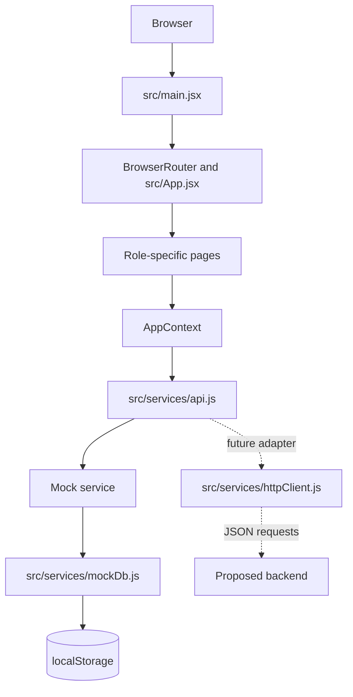

# Architecture

This document describes the current frontend implementation. The application is a Vite-served React single-page app; it does not include an API server or server database. Any server architecture mentioned elsewhere is a proposal.

## High-level structure

`src/main.jsx` composes `StrictMode`, `BrowserRouter`, `ToastProvider`, `AppProvider`, and `App`. The root `src/App.jsx` declares public and protected routes. The shared `src/components/layout/Layout.jsx` provides role-specific navigation for the operational portal; Super Admin has its own portal navigation/page structure.

## Routing and access checks

| Route | Access | Page/workflow |
| --- | --- | --- |
| `/` | Public | `EntryPage`; vehicle lookup and Admin login entry |
| `/login` | Public | Shared `LoginPage` for staff roles |
| `/lookup/:vehicleNumber` | Public | Citizen lookup and vehicle challan details |
| `/citizen/:vehicleNumber` | Public | Alias to the Citizen lookup page |
| `/dashboard`, `/admin/dashboard` | Admin | Admin dashboard |
| `/admin/operations` | Admin | Operations console |
| `/verification`, `/verification/:detectionId` | Admin | Detection queue and evidence review |
| `/approvals`, `/challans`, `/complaints`, `/vehicles`, `/history`, `/reports`, `/settings` | Admin | Operational pages |
| `/super-admin/*` | Super Admin | Separate system dashboard and management sections (`dashboard`, `admins`, `records`, `monitor`, `disputes`, `analytics`, `configuration`, `audit`) |

`src/components/auth/ProtectedRoute.jsx` reads `currentAccount()` and checks the allowed role. Unauthenticated access is redirected to `/login`; a signed-in user with a wrong role is sent to the landing route for their account. This is a client-side navigation guard, not backend authorization. Citizen lookup does not require sign-in.

## Role-aware navigation

Admin and Super Admin have separate route trees and navigation. The shared operational `Layout` exposes Admin pages; the Super Admin view exposes staff/system management, analytics, configuration, and audit areas. Citizen lookup is a public page organized around the entered vehicle number. See [role permissions](ROLE_PERMISSIONS.md) for current actions and the strict rule-configuration boundary.

## State and service layer

`src/context/AppContext.jsx` loads shared operational data through `api` and exposes actions used by pages. It coordinates local UI state, feedback, and workflows such as payment, dispute submission/resolution, challan issue/review, and account/rule management. `src/services/api.js` exports a `mock` and a `rest` implementation; `USE_MOCK_API` in `src/data/config.js` selects the mock implementation (`true` in this repository). UI components should use context/service operations rather than directly mutating storage or calling `fetch`.

The mock API covers detections, vehicles, rules, challans, verification history, and complaints. Other workflows (including authentication, payments, disputes, notifications, accounts, and system settings) are implemented in their service/context layer against the same mock database rather than a remote API.

## Mock database and persistence

`src/data/mockData.js` supplies baseline vehicle, detection, challan, complaint, and verification-history records. `src/data/config.js` supplies illustrative rules and system settings. `src/services/mockDb.js` joins and extends those records, seeds citizens, payments, disputes, notifications, FAQs, staff accounts, and audit history, then reads/writes the object under localStorage key `echallan_mock_database_v2`.

Initial data is used when storage has no valid database. Existing data is retained; limited migration defaults are applied for missing fields (including FAQs, settings/permissions, rule snapshots, and a failed sample payment). `persistDb()` serializes the shared object after workflow changes. `resetDemoData()` restores the in-memory seed and persists it; the Super Admin system-admin path exposes the reset action. Data is local to one browser profile and can be edited by its owner.

## Shared data and portal consistency

All three experiences resolve records from the same database instance in the current browser. Vehicles identify their citizen, challans reference a vehicle number and can reference a detection/dispute, payments reference challan IDs, disputes reference challan/citizen IDs, and notifications/audit entries record workflow changes. Seed data is not fully normalized: some historical links are string-based, officer attribution is often a display name, and evidence is a path rather than a separate asset record. A backend should normalize and enforce foreign keys as described in [Database design](DATABASE_DESIGN.md).

## CCTV evidence

`VIDEO_SRC` in `src/data/config.js` points to `/videos/cctv-evidence.mp4`, served from `public/videos/cctv-evidence.mp4`. Detection/challan UI can open the existing video through the video/evidence components. The clip is shared demo footage; references do not establish camera provenance or prove that the video corresponds to each fictional incident. No camera integration, upload pipeline, or per-evidence backend is present.

## Payment simulation

The Citizen payment UI offers simulated UPI, debit card, credit card, and net banking methods and a demo outcome. The Context/service checks that simulation is enabled, the challan is eligible, and no successful payment already exists. Successful simulation creates a unique transaction record and receipt identifier, sets the challan paid/closed, and updates the shared store. Failure records a failed transaction while leaving the challan unpaid. Receipt output is printable/downloadable demo content; there is no payment gateway or banking data collection.

## Challan lifecycle

The detection workflow supports pending detections and Admin actions such as approve, reject, and send for review. Challan issuance selects active rules, computes line items using `src/utils/fineCalculator.js`, calculates the total, and records a rule snapshot/version. Later configuration edits do not recalculate stored historical amounts. Challan operational status and payment status are separate fields; typical statuses include `Pending Approval`, `Issued`, `Closed`, `Cancelled`, and `Disputed`, while `paymentStatus` is `Unpaid` or `Paid`.

The mock service's `createChallan` requires the `admin` role; `updatePenaltyRules` requires `super-admin` and a reason. These checks protect normal UI flows only. The server must repeat authorization and calculation on trusted data.

## Dispute lifecycle

A Citizen submits a dispute for a challan. The mock workflow creates a dispute record, links it to the challan, marks the challan `Disputed`, and notifies the Admin audience. Admin resolution stores a resolution and moves the challan back to an operational state (or cancellation, based on the selected outcome). The record and resulting audit/notification changes appear in shared views. The current demo has no independently authenticated Citizen identity; public lookup is vehicle-based.

## Extension points

- API selection and REST calls: `src/services/api.js`.
- Base URL and mock switch: `src/data/config.js`.
- Fetch wrapper: `src/services/httpClient.js`.
- Shared workflow state: `src/context/AppContext.jsx`.
- Authentication mock: `src/services/auth.js`.
- Data and migration behavior: `src/services/mockDb.js`.

The current adapter's REST paths are frontend expectations only. See [API documentation](API_DOCUMENTATION.md) for that implemented adapter subset and a broader proposed API contract.
