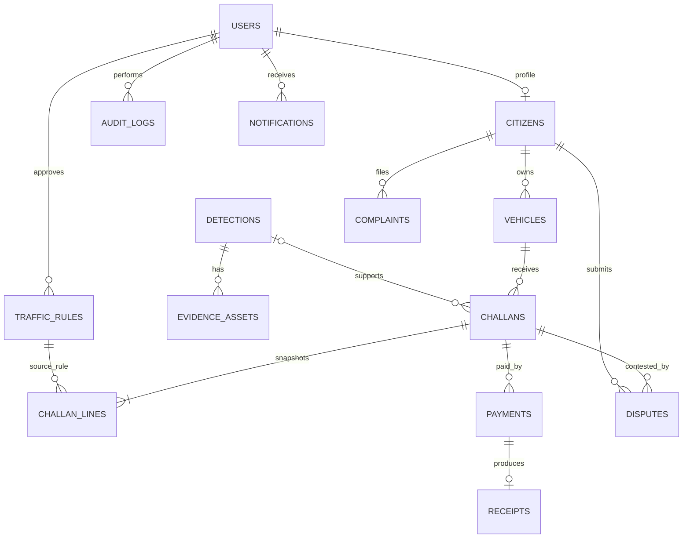

# Data model and backend database design

## Scope and conventions

The current application stores one denormalized JSON object in browser localStorage. It is a demo store, not a SQL schema. This document first records current mock fields, then recommends a relational model suitable for a backend. Proposed fields/types below are design guidance, not existing backend tables or migrations.

Seed values are fictional. Fine amounts and `ruleReference` strings such as `Illustrative demo rule T-01` are not official legal provisions. Current mock status values are case-sensitive.

## Current mock entities

| Collection | Current fields and notes |
| --- | --- |
| `admins` | `id`, `name`, `email`, `password`, `role` (`admin` / `super-admin`), `active`, `designation`. The `password` field is demo-only plaintext and must not be carried into a production schema. There is no Citizen login record in the seed. |
| `citizens` | `id`, `name`, `email`, `phone`, `active`. Citizen is linked to vehicle by `citizenId`. |
| `vehicles` | `registrationNumber`, `ownerName`, `vehicleType`, `registrationDate`, `registrationValidity`, `registrationStatus`, `insurance:{status,expiry}`, `puc:{status,expiry}`, `fitness:{status,expiry}`, `citizenId`. Registration number is used as the vehicle lookup key. |
| `penaltyRules` | `code`, `label`, `group`, `fine`, `ruleReference`, `version`, `active`. `group` distinguishes categories such as `traffic` and `document`; it is not a separate category entity. |
| `detections` | Seed detection records contain an ID, review `status`, violation date/time, `cameraId`, `cameraLocation`, detected registration/category/speed/confidence, and suggested rule codes. The exact optional values vary by record. |
| `challans` | `id`, `detectionId`, `vehicleNumber`, `ownerName`, `violations[]` (line `code`, `label`, `fine`, optional group/rule reference/configuration version), `fineAmount`, `officer`, `generatedAt`, `paymentStatus`, `status`, `evidence`, `disputeId`, `ruleSnapshot[]`, `penaltyRuleVersion`, and optional review/status fields such as `statusReason`, `reviewNote`, `reviewedAt`, `paidAt`, `demoValues`. Seed and migrated records may omit optional fields. |
| `payments` | `id` (transaction ID), `challanId`, `vehicleNumber`, `amount`, `method` (`UPI`, `Debit Card`, `Credit Card`, `Net Banking`), `status` (`Success` / `Failure`), `at`, and `receiptId` (null for failed example). |
| `disputes` | `id`, `challanId`, `vehicleNumber`, `citizenId`, `reason`, `details`, `status` (`Pending` / `Resolved`), `resolution`, `submittedAt`, optional `resolvedAt`. |
| `complaints` | Seed records use `id`, `citizenName`, `contact:{phone,email}`, `vehicleNumber`, `category`, `description`, `submittedAt`, `attachments`, `status`, `remarks`, and `resolution`. They are operational grievances and are distinct from the challan-linked `disputes` collection. |
| `history` | Verification entries use `id`, `detectionId`, `vehicleNumber`, `action`, `officer`, `at`, `reason`, and optional `challanId`. |
| `notifications` | `id`, `message`, `audience`, `at`, `read`. Audience can be a role-like value, `all`, or a registration number. There is no normalized recipient/read-receipt relation. |
| `audit` | `id`, `actor`, `action`, `target`, `at`, and optional `previous`, `next`, `reason`. Actor is generally a name string rather than account FK. |
| `settings` | `systemName`, `maintenanceMode`, `paymentSimulation`, `penaltyRuleVersion`, and `permissions` object. |
| `faqs` | `id`, `question`, `answer`. |

The mock store uses arrays and embedded snapshots, not database-enforced foreign keys. Some relations are via registration-number strings. Evidence may be a shared video path; complaint attachments are references, not uploaded files.

## Recommended relational entities

Types below are illustrative SQL-style types. Choose equivalents appropriate to the backend database. Use UTC timestamps and decimal currency types (never floating point for money). IDs should be generated server-side.

### Users and role assignments

**Proposed tables:** `users`, `roles`, optionally `user_roles` or constrained `users.role`.

| Field | Suggested type | Key / rule |
| --- | --- | --- |
| `id` | UUID | PK |
| `name` | VARCHAR(160) | Required |
| `email` | VARCHAR(254) | Required, unique, normalized |
| `password_hash` | VARCHAR(255) | Required for password auth; never plaintext |
| `role` | ENUM or role FK | `citizen`, `admin`, `super_admin`; authorize server-side |
| `active` | BOOLEAN | Required; inactive accounts cannot authenticate |
| `designation` | VARCHAR(160), nullable | Staff display/job title |
| `created_at`, `updated_at` | TIMESTAMPTZ | Required |

Current staff roles exist in `admins`; Citizens have profile records but no authenticated account. The proposed `users` model is a backend normalization, not current behavior.

### Citizens

| Field | Suggested type | Key / rule |
| --- | --- | --- |
| `id` | UUID | PK |
| `user_id` | UUID, nullable | FK `users.id`, unique if linked; public lookup need not require a login |
| `name` | VARCHAR(160) | Required |
| `email` | VARCHAR(254), nullable | Valid email; unique when present as account identity |
| `phone` | VARCHAR(32), nullable | Normalize and validate |
| `active` | BOOLEAN | Required |
| `created_at`, `updated_at` | TIMESTAMPTZ | Required |

Current equivalents: `id`, `name`, `email`, `phone`, `active`.

### Vehicles

| Field | Suggested type | Key / rule |
| --- | --- | --- |
| `id` | UUID | PK |
| `registration_number` | VARCHAR(32) | Unique normalized lookup key; preserve formatted display value separately if needed |
| `citizen_id` | UUID | FK `citizens.id`; ownership changes should be historized |
| `vehicle_type` | VARCHAR(80) | Required controlled vocabulary or reference table |
| `registration_date`, `registration_validity` | DATE | Validate date order |
| `registration_status` | VARCHAR(32) | Current demo uses `Valid`; define allowed values |
| `insurance_status`, `insurance_expiry` | VARCHAR(32), DATE | Current demo stores nested `insurance` object |
| `puc_status`, `puc_expiry` | VARCHAR(32), DATE | Current demo stores nested `puc` object |
| `fitness_status`, `fitness_expiry` | VARCHAR(32), DATE | Current demo stores nested `fitness` object |
| `created_at`, `updated_at` | TIMESTAMPTZ | Required |

### Traffic rules and violation categories

**Proposed tables:** `violation_categories`, `traffic_rules`, `rule_versions` (or temporal/versioned rules).

| Field | Suggested type | Key / rule |
| --- | --- | --- |
| `id` | UUID | PK |
| `code` | VARCHAR(64) | Unique stable identifier, corresponds to mock `code` |
| `label` | VARCHAR(200) | Required |
| `category_id` | UUID | FK `violation_categories.id`; current mock uses `group` strings |
| `legal_reference` | VARCHAR(240) | Required for real law deployment; demo references are explicitly illustrative |
| `fine_amount` | DECIMAL(12,2) | Non-negative; use approved currency and jurisdiction |
| `version` | INTEGER | Monotonically increasing approved configuration version |
| `active` | BOOLEAN | Inactive rules cannot be newly applied |
| `effective_from`, `effective_to` | TIMESTAMPTZ, nullable | Prevent overlapping effective versions as policy requires |
| `changed_by` | UUID | FK `users.id`, must have Super Admin authorization |
| `change_reason` | TEXT | Required on sensitive change |

Current mock fields: `code`, `label`, `group`, `fine`, `ruleReference`, `version`, `active`. Super Admin is the only authorized editor.

### Detections and evidence

**Proposed tables:** `detections`, `evidence_assets`.

`detections`: `id` UUID PK; `registration_number` or `vehicle_id` FK; `detected_at` TIMESTAMPTZ; `camera_id`, `camera_location`; `violation_category`; `detected_speed`; `confidence`; `status`; reviewer user FK; review timestamps/reason. Validate allowed state transitions and never trust detector output as a legally established violation without review policy.

`evidence_assets`: `id` UUID PK; `detection_id` FK; `challan_id` nullable FK; `storage_key`; `content_type`; `size_bytes`; `sha256`; `captured_at`; `uploaded_by`; `retention_until`; `access metadata`. Store content in controlled object storage; DB stores metadata. Current mock has no evidence collection: it stores a video path on challans/detections and attachment references on complaints.

### Challans and line-item snapshots

**Proposed tables:** `challans`, `challan_lines`.

| Field | Suggested type | Key / rule |
| --- | --- | --- |
| `challans.id` | UUID or VARCHAR | PK; current IDs are `CH-...` strings |
| `detection_id` | UUID, nullable | FK `detections.id`; unique if one challan per detection is policy |
| `vehicle_id` | UUID | FK `vehicles.id` |
| `issued_by` | UUID | FK `users.id` with Admin role |
| `status` | ENUM | Demo values include `Pending Approval`, `Issued`, `Closed`, `Cancelled`, `Disputed` |
| `payment_status` | ENUM | Demo values `Unpaid`, `Paid`; backend should derive/guard from payment ledger |
| `fine_amount` | DECIMAL(12,2) | Non-negative total; equal sum of immutable line snapshots |
| `rule_configuration_version` | INTEGER | Version used at issuance |
| `generated_at` | TIMESTAMPTZ | Server timestamp |
| `status_reason` | TEXT, nullable | Required for reject/cancel/review transition as policy specifies |

Each `challan_lines` row should reference the rule and preserve `rule_code`, `rule_label_snapshot`, `legal_reference_snapshot`, `fine_amount_snapshot`, and `configuration_version`. This prevents later rule edits from silently changing an issued challan or paid amount. Current mock embeds `violations[]` and `ruleSnapshot[]` with `code`, `label`, `fine`, `ruleReference`, and `configurationVersion`; `vehicleNumber`, `ownerName`, `officer`, and optional `evidence` are also stored on challans.

### Payments and receipts

**Proposed tables:** `payments`, `receipts`.

`payments`: `id` UUID PK; `challan_id` FK; `amount` DECIMAL(12,2); `method`; `status` (`initiated`, `succeeded`, `failed`, `refunded` as supported); `provider_reference` nullable; `idempotency_key` unique; timestamps; failure code/message safe for display. A uniqueness/transaction rule must prevent more than one settled payment for a payable challan unless partial payments are explicitly supported.

`receipts`: `id` UUID PK; `payment_id` unique FK; `receipt_number` unique; `issued_at`; immutable amount, challan/vehicle and payer display snapshots. Current mock uses `id`, `challanId`, `vehicleNumber`, `amount`, `method`, `status`, `at`, and `receiptId` on a payment record; successful results have receipts, the failed example does not.

### Disputes and grievances

`disputes`: `id` UUID PK; `challan_id` FK; `citizen_id` FK; `reason`; `details`; `status` (`Pending`, `Resolved` in the demo; backend may add `Under Review`, `Rejected`); `resolution`; `submitted_at`; `resolved_by` user FK; `resolved_at`. Validate that only an eligible challan can be disputed and that only an authorized reviewer can resolve it. Current fields are listed above under `disputes`.

`complaints`: `id` UUID PK; nullable `citizen_id` FK; contact snapshot; vehicle FK nullable; category; description; attachment relations; status (`Pending`, `Under Review`, `Resolved`, `Rejected`); resolution; timestamps. Current `complaints` are distinct from challan disputes and include embedded contact/remarks/attachment references.

### Notifications, audit, and configuration

- `notifications`: UUID PK, audience/recipient FK or role, message, created timestamp, read timestamp. Current mock has one `audience` string and boolean `read`.
- `audit_logs`: UUID PK, actor user FK, action, target type/id, timestamp, reason, structured previous/new value JSON. Restrict read access; append-only for application roles. Current seed uses display-name `actor` and optional `previous`/`next` JSON.
- `system_configurations`: key, typed value, version, updated by user FK, reason, timestamp. Current mock keeps `settings` as one object with maintenance/payment toggles, version and permission lists.
- Optional `faqs`: UUID PK, question, answer, active, sort order. Current mock stores `id`, `question`, `answer`.

## Relationships

This diagram is a proposed normalized backend design. The existing local mock uses arrays, embedded values, and string references instead of these foreign keys.

## Integrity rules

1. Only Super Admin may create, edit, activate/deactivate, or retire global rules, legal provisions, categories, and fines; Citizen/Admin reads are read-only.
2. Admin challan issuance must calculate against the active approved rule configuration on the server, never a client-submitted fine.
3. Persist the rule code/label/legal reference/fine/configuration version snapshot for every issued line item.
4. Rule changes require actor, UTC time, previous and new values, and reason in an audit record. Do not mutate old challans or settled payment records when a rule changes.
5. Payment settlement and challan state update must be atomic and idempotent. Failed payments do not mark a challan paid.
6. Enforce uniqueness and ownership with database constraints and transactional service logic, not browser-side state alone.
